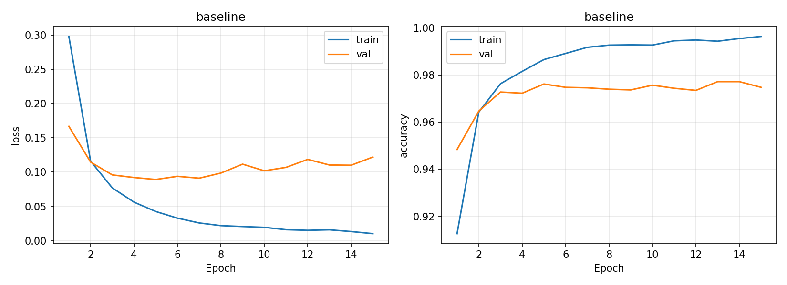
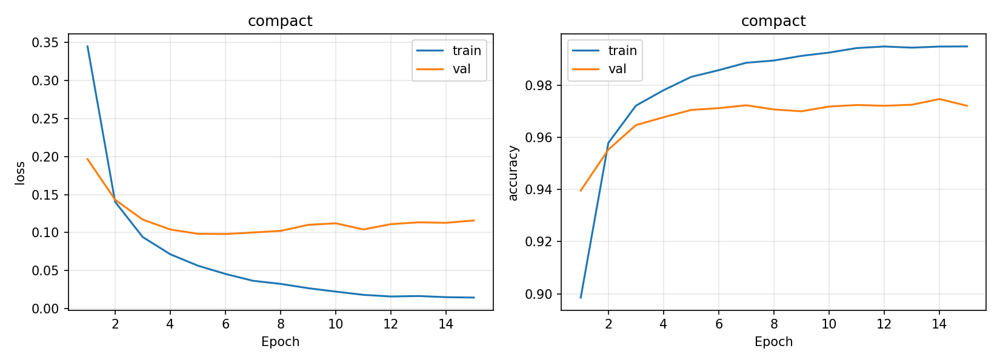
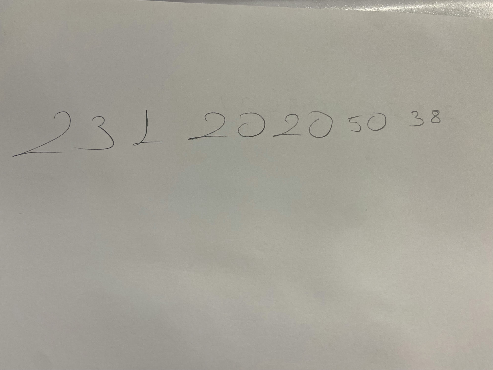

# MNIST ile MLP tabanlı el yazısı rakam tanıma

Proje deposu: https://github.com/mubakli/Derin-ogrenme-1

CNN ve hazır ağırlık kullanılmadan, PyTorch ile sıfırdan eğitilen iki MLP yapılandırmasının karşılaştırılması.

## Kurulum ve eğitim

Python 3.9 veya üzeri kullanın. Komutları proje klasöründe çalıştırın:

```bash
python3 -m venv .venv
source .venv/bin/activate
python -m pip install -r requirements.txt
python train.py
```

Windows'ta ortam etkinleştirme: `.venv\Scripts\activate`.
İlk çalıştırmada MNIST internetten indirilir. CUDA varsa GPU, yoksa CPU kullanılır.
Bu bilgisayarda kurulan sürümler: Python 3.9.6, PyTorch 2.8.0, torchvision 0.23.0,
NumPy 2.0.2, Matplotlib 3.9.4 ve Pillow 11.3.0 (macOS ARM64).

Temel kontroller: `python -m unittest -v` (veri indirmez ve eğitim yapmaz).

## Deney tasarımı

| Parametre | Değer |
|---|---|
| Temel model | 784 → 256 → 128 → 10 |
| Karşılaştırma modeli | 784 → 128 → 64 → 10 |
| Gizli katman aktivasyonu | ReLU |
| Kayıp | CrossEntropyLoss |
| Optimizer | Adam; varsayılan betalar (0.9, 0.999), weight decay 0 |
| Öğrenme oranı | 0.001 |
| Epoch | 15 |
| Batch size | 128 |
| Seed | 42 |
| Normalizasyon | (piksel / 255 − 0.1307) / 0.3081 |
| Veri ayrımı | 50.000 train / 10.000 validation / 10.000 test |

MNIST'in resmi 60.000 eğitim görüntüsü sabit seed ile train/validation olarak bölünür. Resmi test kümesi, iki deney tamamlanıp validation loss ile model ve checkpoint seçildikten sonra yalnızca seçilen modeli değerlendirmek için kullanılır. Kendi el yazısı eğitimde kullanılmaz. Seed tekrarlanabilirliği destekler; farklı donanımlarda birebir aynı sonuç garanti edilmez.

Örnek alternatif: `python train.py --epochs 20 --lr 0.0005`. Yeniden çalıştırmak aynı isimli çıktıları yeniler; önceki deneyleri saklamak için `outputs` klasörünü önce farklı adla arşivleyin. Test sonuçlarına göre hiperparametre ayarlamayın.

## El yazısı fotoğrafının hazırlanması

1. Kendi çektiğiniz **tam ikinci fotoğraf** `data/handwriting/student_number.png` olarak saklanır.
2. `python prepare_handwriting.py` bu fotoğrafa özel, elle belirlenmiş kutularla 11 rakamı kırpar. Mevcut kırpımlar varsa üzerine yazmaz. Kutular `data/handwriting/crop_boxes.json` içinde belgelenir; model tahminlerine göre seçilmez.
3. Kırpımlar `data/handwriting/digits/` klasöründe **00.png, 01.png, …, 10.png** adlarıyla saklanır. Sıra gerçek numara olan `23120205038` ile eşleşir. Başka fotoğraflar için kutular yeniden belirlenmelidir; bu kod genel amaçlı OCR değildir.
4. Eğitimin ardından çalıştırın:

```bash
python predict.py --labels 23120205038
```

Ön işleme gri tonlama, yerel arka plan çıkarımı, koyu çizgileri açık renk mürekkebe dönüştürme, rakam sınırına kırpma, en büyük boyutu 20 piksele ölçekleme, 28×28 siyah tuvale yerleştirme, kütle merkezi hizalama ve eğitimle aynı normalizasyonu uygular. Bu işlemlerin sonucunu `outputs/handwriting/montage.png` üzerinden kontrol edin. İnce kalem çizgileri veya gölgeler nedeniyle bilgi kaybı olabilir; başarı garanti edilmez.

## Sonuçlar ve teslim

İki model de CPU üzerinde 15 epoch sıfırdan eğitilmiştir. Aşağıdaki değerler gerçek çalıştırma sonuçlarıdır. Tablodaki train/validation metrikleri, her modelin en düşük validation loss elde ettiği epoch'a aittir.

| Model | Seçilen epoch | Train loss | Validation loss | Train accuracy | Validation accuracy | Toplam eğitim süresi |
|---|---|---|---|---|---|---|
| 784–256–128–10 | 5 | 0.0426 | 0.0893 | %98.66 | %97.62 | 82.68 sn |
| 784–128–64–10 | 6 | 0.0456 | 0.0981 | %98.58 | %97.12 | 79.78 sn |

Validation loss ile seçilen **temel modelin test doğruluğu %97.59**, test loss değeri **0.0841** olmuştur. Test kümesi yalnızca seçilen model için değerlendirilmiştir.

- [Ayrıntılı deney raporu](outputs/report.md)
- [Kendi el yazısı değerlendirmesi](outputs/handwriting.md)

### Eğitim grafikleri




### Gerçek el yazısı sonucu

Özgün fotoğraftan kırpılan numara: **23120205038**.
Modelin tahmini: **55555505232**.
Rakam bazında doğruluk: **3/11 = %27.27**. Numaranın tamamı doğru tanınamamıştır.
Doğru tahmin edilenler 7. sıradaki `0`, 8. sıradaki `5` ve 10. sıradaki `3` rakamlarıdır.




### Genel değerlendirme

Temel model daha düşük validation loss ve daha yüksek validation doğruluğu elde etmiş; yaklaşık 2.9 saniye daha uzun sürmüştür. Bu karşılaştırma tek seed'e dayandığı için genel veya istatistiksel bir üstünlük iddiası değildir.

Temel modelde 5. epoch'tan 15. epoch'a training loss 0.0426'dan 0.0103'e düşerken validation loss 0.0893'ten 0.1220'a yükselmiştir. Training accuracy %99.64'e ulaşmasına rağmen validation accuracy %97.48 olmuştur. Bu durum aşırı öğrenme (overfitting) işaretidir. Bu nedenle son epoch yerine validation loss ile seçilen 5. epoch ağırlıkları kullanılmıştır. Küçük modelde de son epoch validation loss, seçilen epoch'a göre daha yüksektir.

MNIST test başarısının yüksek olması, gerçek fotoğrafta aynı başarının elde edileceğini garanti etmemiştir. Kişisel örnekte çizgiler oldukça ince ve bazı rakamların taban çizgileri uzundur; ışık, gölge ve yazım biçimi de MNIST'ten farklıdır. Ön işlenen görüntülerde rakamlar görünse de kalınlık ve yoğunluk farkları modelin öğrendiği dağılımla uyumsuz olabilir. Bunlar olası açıklamalardır; nedenleri ayrı deneylerle doğrulanmamıştır. Bazı yanlış tahminlerde softmax skorunun yüksek olması, bu skorun gerçek dünyada güven garantisi olmadığını gösterir.

Kişisel örnek sonucu görüldükten sonra model, kırpma kutuları veya ön işleme ayarları değiştirilmemiştir. Bu nedenle düşük sonuç da olduğu gibi raporlanmıştır. Gelecekte veri artırma veya farklı çizgi kalınlıklarıyla eğitim ayrı deneyler olarak incelenebilir; bu çalışmada uygulanmamıştır. Tek öğrenci numarası, tüm gerçek el yazıları için başarı tahmini sağlamaz.

Oluşturulan dosyalar:
- `outputs/report.md`: gerçek eğitim/doğrulama metrikleri, süreler ve seçilen modelin test sonucu.
- `outputs/results.json`: hiperparametreler, cihaz ve ayrıntılı sonuçlar.
- `outputs/*_history.csv`: her epoch için loss/accuracy.
- `outputs/*_curves.png`: train/validation grafikleri.
- `outputs/handwriting.md`: gerçek rakamlar, tahminler, doğruluk ve genel değerlendirme.
- `outputs/handwriting/`: MNIST biçimine dönüştürülen gerçek el yazısı görüntüleri.

Teslimden önce sonuç dosyalarını okuyun ve kendi gözlemlerinizi ekleyin: doğrulama kaybı yükselirken eğitim kaybı düşüyor mu (overfitting)? Daha büyük modelin ek maliyeti karşılığında doğrulama başarısı artmış mı? El yazısında hangi rakamlar karışmış? Test başarısı ile kişisel örnek başarısı neden farklı olabilir? İki modelin tek seed ile karşılaştırılması kesin istatistiksel üstünlük göstermez.

Depo kodları, README'yi, gerçek fotoğraf/kırpımları, raporları ve grafikleri içerir. MNIST dosyaları ve model ağırlıkları `.gitignore` ile dışarıda bırakılır; ağırlıklar kod çalıştırılarak yeniden oluşturulabilir. **Öğrenci numarası kişisel bilgidir; herkese açık depoda paylaşmadan önce dersin teslim ve gizlilik gereksinimlerini kontrol edin.**

## Kodu açıklamak için kısa notlar

- 28×28 görüntü düzleştirilerek 784 sayı olur; MLP bu sayılardan özellik öğrenir.
- İki gizli katman ReLU ile doğrusal olmayan ilişkileri öğrenir.
- Son katman 10 logit üretir. CrossEntropyLoss eğitim sırasında gerekli log-softmax işlemini içerir.
- Backpropagation gradyanları hesaplar; Adam ağırlıkları günceller.
- Validation eğitim ayarlarını seçmek, test ise son genelleme başarısını ölçmek içindir.
- Loss modelin hatasına ilişkin sürekli bir ölçüdür; accuracy doğru tahminlerin oranıdır.
